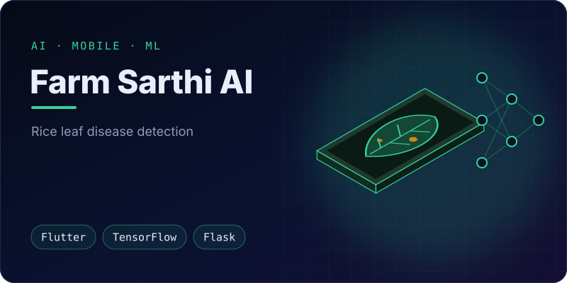
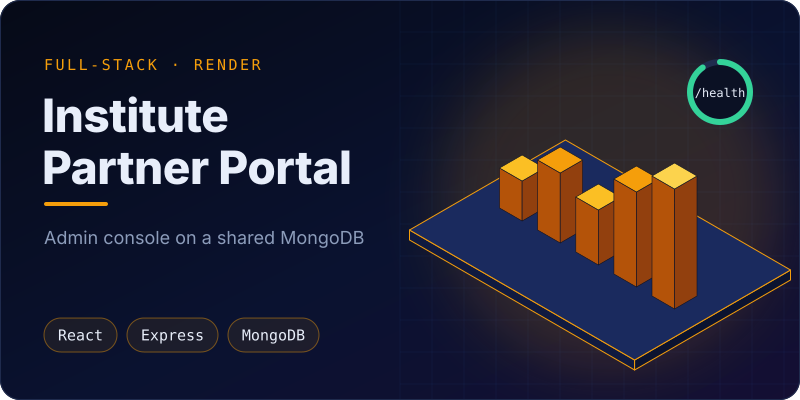
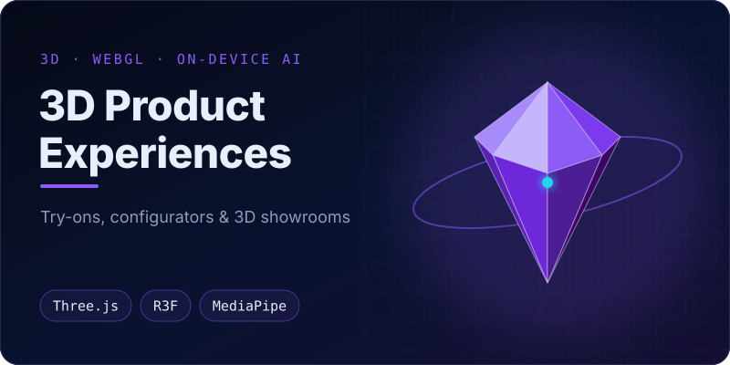
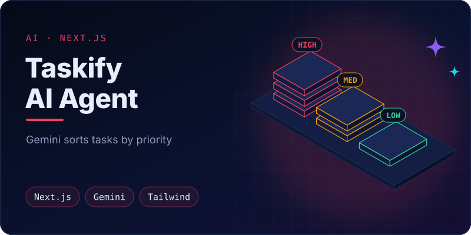

  

  

  &nbsp;
  &nbsp;
  &nbsp;
  

  

## 01 · About me

I'm a developer from **Belgaum, Karnataka, India**, moving from full-stack development into **DevOps**. I've spent the last few years shipping web and mobile apps with **React, Next.js, Node.js and Flutter**, and now I focus on what happens after the code is written: packaging apps into containers, automating their deployments, and running them on cloud infrastructure.

Building the apps myself means I treat infrastructure as part of the product. I want deploys that are repeatable, configuration that stays out of the code, and a pipeline that turns `git push` into a running service.

<table>
  <tr>
    <td width="50%" valign="top">
      <b>🔁 CI/CD automation</b> 
      GitHub Actions workflows that deploy on every push to <code>main</code>, with credentials kept in GitHub Secrets.
    </td>
    <td width="50%" valign="top">
      <b>📦 Containers</b> 
      Dockerfiles and Docker Compose stacks for React and Next.js apps, including a Next.js + PostgreSQL setup.
    </td>
  </tr>
  <tr>
    <td width="50%" valign="top">
      <b>☁️ Cloud deployments</b> 
      AWS EC2 (Ubuntu) over SSH, plus Vercel, Netlify and Render blueprints with health checks and auto-deploy.
    </td>
    <td width="50%" valign="top">
      <b>🧩 Full-stack and AI</b> 
      MERN and Next.js + Prisma apps, Flutter mobile apps, and Gemini, OpenAI and TensorFlow integrations.
    </td>
  </tr>
</table>

## 02 · DevOps toolchain

How I take a project from idea to production. Each stage lists tools I've used in my own repositories, and the dashed items are the ones I'm learning now.

  

The deployment path below is based on my [Applied DevOps & Deployment Engineering](https://github.com/FaisalNadaf/APPLIED-DEVOPS-AND-DEPLOYMENT-ENGINEERING) project. The green arc is what runs today. The dashed registry step is the next improvement: build the image in CI, push it to a registry, and have the server pull it.

  

## 03 · Tech stack

<table>
  <tr>
    <td width="50%" valign="top">
      <b>☁️ Cloud &amp; hosting</b>  
       
      + Render · Cloudflare Workers (basics)
    </td>
    <td width="50%" valign="top">
      <b>📦 Containers &amp; CI/CD</b>  
       
      + Docker Compose · GitHub Secrets
    </td>
  </tr>
  <tr>
    <td valign="top">
      <b>🐧 Linux &amp; shell</b>  
       
      Ubuntu servers on AWS EC2
    </td>
    <td valign="top">
      <b>💻 Languages</b>  
       
      Most of my code is TypeScript and JavaScript
    </td>
  </tr>
  <tr>
    <td valign="top">
      <b>🧩 Backend &amp; APIs</b>  
       
      + Socket.io · JWT auth · REST APIs
    </td>
    <td valign="top">
      <b>🗄️ Databases</b>  
       
      + Firestore · Redis (basics)
    </td>
  </tr>
  <tr>
    <td valign="top">
      <b>🎨 Frontend &amp; mobile</b>  
       
      Where I started, and still ship
    </td>
    <td valign="top">
      <b>🤖 AI &amp; testing</b>  
       
      + Gemini &amp; OpenAI APIs · Playwright · ESLint
    </td>
  </tr>
  <tr>
    <td colspan="2" valign="top">
      <b>🌱 Currently learning</b>: the next layer of the DevOps stack  
       
      Kubernetes · Terraform · Prometheus · Grafana · Nginx. Not production experience yet.
    </td>
  </tr>
</table>

## 04 · Featured projects

<table>
  <tr>
    <td width="50%" valign="top">
      
      <h3><a href="https://github.com/FaisalNadaf/APPLIED-DEVOPS-AND-DEPLOYMENT-ENGINEERING">Auto-Deploy Pipeline</a></h3>
      A React app packaged with Docker and Docker Compose. A GitHub Actions workflow SSHes into an Ubuntu EC2 instance on every push to <code>main</code>, pulls the latest code and rebuilds the containers.
        <code>Docker</code> <code>Compose</code> <code>GitHub Actions</code> <code>AWS EC2</code> <code>React</code>
    </td>
    <td width="50%" valign="top">
      
      <h3><a href="https://github.com/FaisalNadaf/INNB001-FARM-SARTHI-AI">Farm Sarthi AI</a></h3>
      A cross-platform Flutter app for farmers. It sends a photo of a rice leaf to a TensorFlow/Keras model served by a Flask API, then shows the predicted disease, its symptoms and remedies in several languages.
        <code>Flutter</code> <code>TensorFlow</code> <code>Flask</code> <code>OpenCV</code> <code>MongoDB</code>
    </td>
  </tr>
  <tr>
    <td width="50%" valign="top">
      
      <h3><a href="https://github.com/FaisalNadaf/JGI-GANAKA-VIDYA">Institute Partner Portal</a></h3>
      An admin console for partner institutes on a rural learning platform, sharing one MongoDB database with the student app. The API is deployed through a Render blueprint with a health-check path, auto-deploy and generated secrets.
        <code>React</code> <code>Express</code> <code>MongoDB</code> <code>JWT</code> <code>Render</code>
    </td>
    <td width="50%" valign="top">
      
      <h3><a href="https://github.com/FaisalNadaf/3D-products-wear-and-test">3D Product Experiences</a></h3>
      A multi-page showcase with a jewellery try-on, a watch configurator, a T-shirt designer and a curtain visualizer. Camera tracking runs on the device with self-hosted MediaPipe, so no images are uploaded.
        <code>Three.js</code> <code>React Three Fiber</code> <code>MediaPipe</code> <code>TypeScript</code> <code>Vite</code>
    </td>
  </tr>
  <tr>
    <td width="50%" valign="top">
      
      <h3><a href="https://github.com/FaisalNadaf/CHAT_APP">Real-Time Chat App</a></h3>
      A MERN chat app with Socket.io messaging, online presence, JWT authentication and Zustand for global state, with error handling on both client and server.
        <code>MongoDB</code> <code>Express</code> <code>React</code> <code>Node.js</code> <code>Socket.io</code>
    </td>
    <td width="50%" valign="top">
      
      <h3><a href="https://github.com/FaisalNadaf/taskify-ai-agent">Taskify AI Agent</a></h3>
      A Next.js task manager that reads each task's description and uses Gemini to sort it into high, medium or low priority automatically.
        <code>Next.js</code> <code>TypeScript</code> <code>Gemini API</code> <code>Tailwind CSS</code>
    </td>
  </tr>
</table>

## 05 · GitHub analytics

  

  
  

  

## 06 · Now learning

- **Container registries.** Building images in GitHub Actions and pushing them to GHCR, so servers pull a tested image instead of building on the host.
- **Kubernetes.** Moving from single-host Docker Compose to Deployments, Services and rolling updates.
- **Terraform.** Defining the EC2 and networking setup as code instead of configuring it by hand.
- **Prometheus and Grafana.** Going beyond health checks to metrics, dashboards and alerts.

## 07 · Hackathons and builds

- [**EVOGEN Hackathon 2025**](https://github.com/FaisalNadaf/EVOGEN-HACKATHON-2025): a web app built during the event.
- [**HackVyuha**](https://github.com/FaisalNadaf/hackvyuha-21): a CCTV detection prototype with a Python detection module, a backend and a client.
- [**Nova Creator Cosmic Dev Night**](https://github.com/FaisalNadaf/Nova-Creator-Cosmic-dev-night-challenge): a Titanic survival prediction model with feature engineering and model comparison.

<!-- Add verified certifications here, e.g.  - **AWS Certified Cloud Practitioner** (issuer, year) -->

## 08 · Let's connect

I'm open to **DevOps, cloud and full-stack roles**, freelance work and collaborations. The fastest way to reach me is [email](mailto:faisalfnadaf@gmail.com) or [LinkedIn](https://www.linkedin.com/in/faisal-nadaf-429160281/). You can also see more of my work on my [portfolio](https://faisal-development.netlify.app).

  

