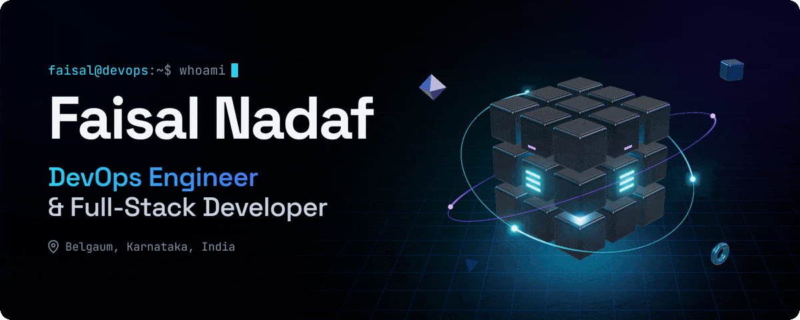
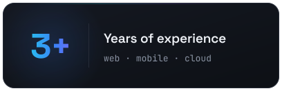
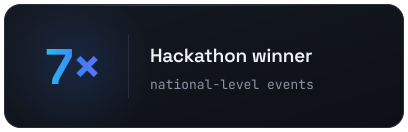
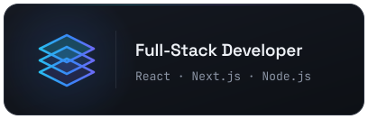

  <picture>
    <source media="(prefers-reduced-motion: reduce)" srcset="assets/hero/hero-static.png" />
    
  </picture>

  &nbsp;
  &nbsp;
  &nbsp;
  

   
  

## About me

I'm a DevOps Engineer and Full-Stack Developer with 3+ years of experience building and shipping software. I started with web and mobile apps in React, Next.js, Node.js and Flutter. Now I focus on what happens after the code is written: packaging services into containers, automating deployments and running them on Linux servers in the cloud.

Because I build the apps myself, I treat infrastructure as part of the product. I want deploys that are repeatable, configuration that stays out of the code, and a pipeline that turns `git push` into a running service.

- **CI/CD:** GitHub Actions workflows that deploy on every push to `main`, with credentials kept in GitHub Secrets.
- **Containers:** Dockerfiles and Docker Compose stacks for React and Next.js apps, including a Next.js and PostgreSQL setup.
- **Cloud and servers:** Ubuntu on AWS EC2 deployed over SSH, plus Vercel, Netlify and Render with health checks and auto-deploy.
- **Full-stack and AI:** MERN and Next.js + Prisma apps, Flutter mobile apps, and Gemini, OpenAI and TensorFlow integrations.

## Tech stack

#### DevOps & Cloud

&nbsp;

<code>CI/CD&nbsp;pipelines</code> <code>Cloud&nbsp;infrastructure</code> <code>Server&nbsp;deployment</code> <code>Monitoring&nbsp;&amp;&nbsp;automation</code> <code>Docker&nbsp;Compose</code> <code>GitHub&nbsp;Secrets</code>

Exploring next: Terraform for infrastructure as code, Prometheus and Grafana for metrics and alerts, and container registries (GHCR) so servers pull tested images.

#### Programming Languages

#### Frontend Development

 
React Three Fiber · Zustand

#### Backend Development

 
Socket.io · JWT authentication · REST APIs

#### Databases

 
Firestore · Redis (basics)

#### Tools & Platforms

 
Render · Cloudflare Workers (basics) · Playwright · ESLint

#### Mobile Development

 
Cross-platform mobile apps with Flutter and Dart

#### AI & Automation

 
Gemini and OpenAI API integrations · automatic task prioritization with Gemini · TensorFlow/Keras models served through Flask

## How I ship

  

Based on my <a href="https://github.com/FaisalNadaf/APPLIED-DEVOPS-AND-DEPLOYMENT-ENGINEERING">Applied DevOps & Deployment Engineering</a> project. The green path runs today; the dashed registry step is the next improvement.

## GitHub activity

  

## Let's connect

I'm open to DevOps, cloud and full-stack roles, freelance work and collaborations. The quickest way to reach me is by [email](mailto:faisalfnadaf@gmail.com) or on [LinkedIn](https://www.linkedin.com/in/faisal-nadaf-429160281/), and you can see more of my work on my [portfolio](https://faisal-development.netlify.app).

  

  

